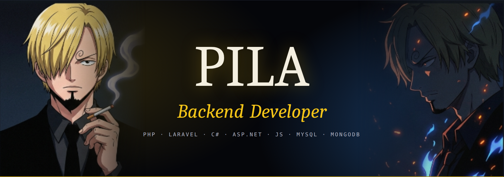

<div align="center">



<a href="https://github.com/Sanji4126">
  
</a>

<br/><br/>

[](#)
[](mailto:khornpila23@gmail.com)
[](https://github.com/Sanji4126)

</div>

---

### about

Designing robust server-side architectures, RESTful APIs and scalable database systems. I build production-grade services with **PHP (Laravel)**, **C# (.NET)** and **JavaScript / Node.js**, backed by **MySQL** and **MongoDB**, and I'm applying for a **Web Backend internship**.

> **Building:** REST API backends, auth services, query optimization
> **Focus:** normalization and indexing, Redis caching, clean architecture

---

### core skills

<p align="left">
  
</p>

```yaml
backend  : PHP · Laravel · C# · ASP.NET Core · Node.js · Express · REST · JWT/OAuth2
database : MySQL · MongoDB · Eloquent ORM · Entity Framework Core
status   : seeking web backend internship
```

---

### featured backend projects

| Case | Highlights | Stack |
| :--- | :--- | :--- |
| **E-Commerce REST API Engine** | JWT auth, RBAC, transactions, inventory locking, payment webhooks | `PHP` `Laravel` `MySQL` `Redis` |
| **Enterprise Inventory API** | Clean Architecture, repository pattern, MongoDB documents, Docker | `C#` `ASP.NET Core` `MongoDB` `Docker` |
| **Event & Notification Gateway** | Async live notifications, Redis session cache, token-bucket rate limiting | `Node.js` `Express` `MongoDB` `Redis` |

<!-- Replace each project name with a link to the real repo once it is pushed. -->

---

### github stats

<div align="center">
  
  
  <br/>
  
</div>

<br/>

<div align="center">
  
</div>

---

<div align="center">
  <sub>designed for web backend engineering · built by KHORN PILA</sub>
  
</div>
